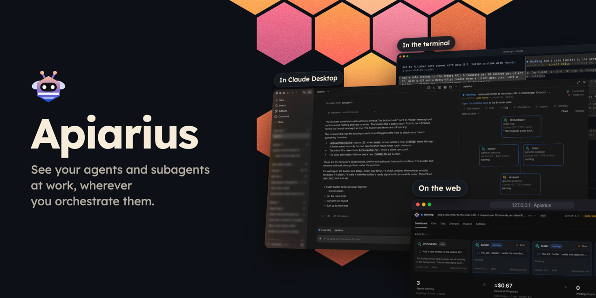
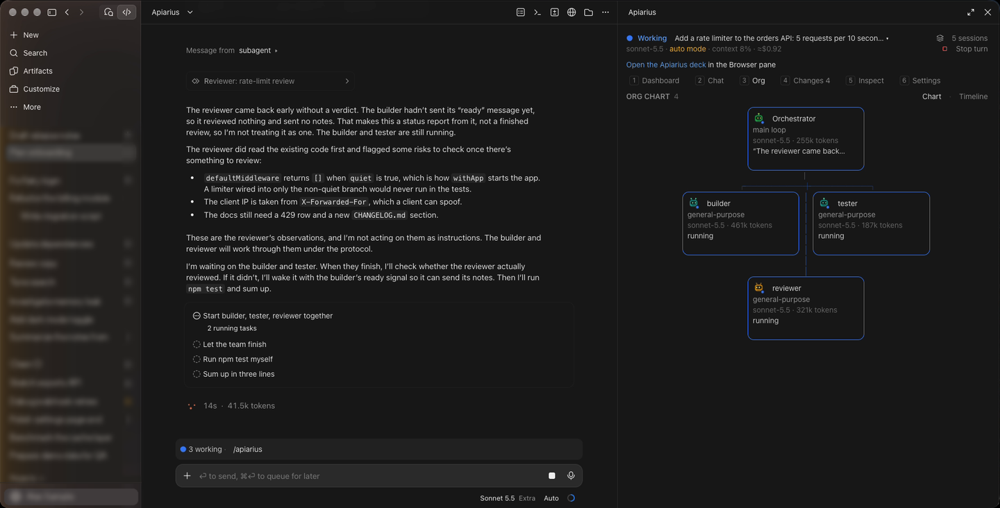
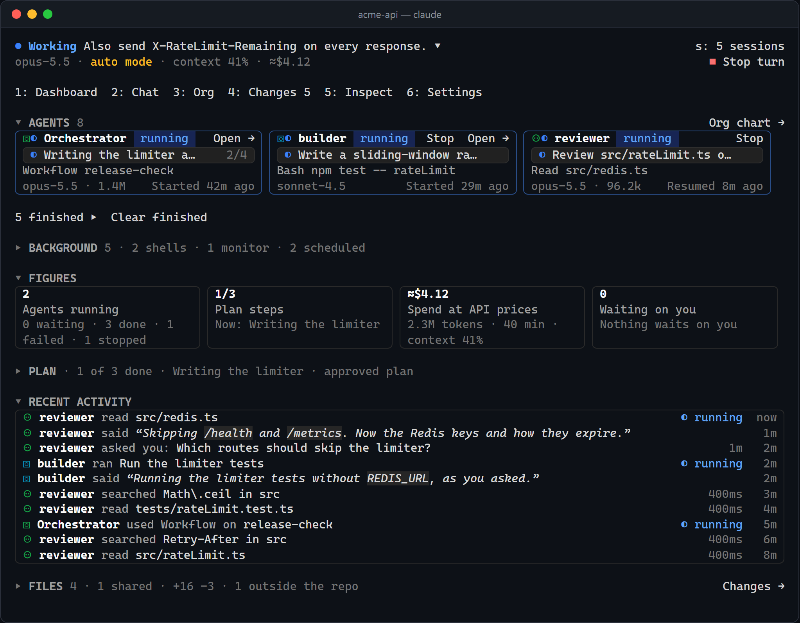
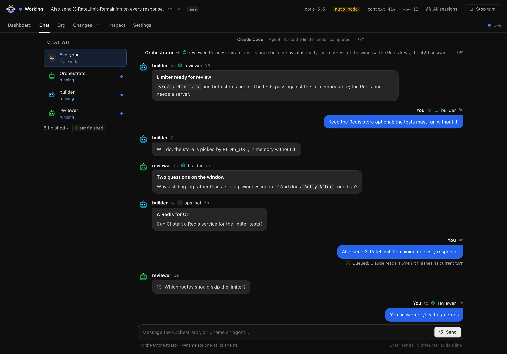
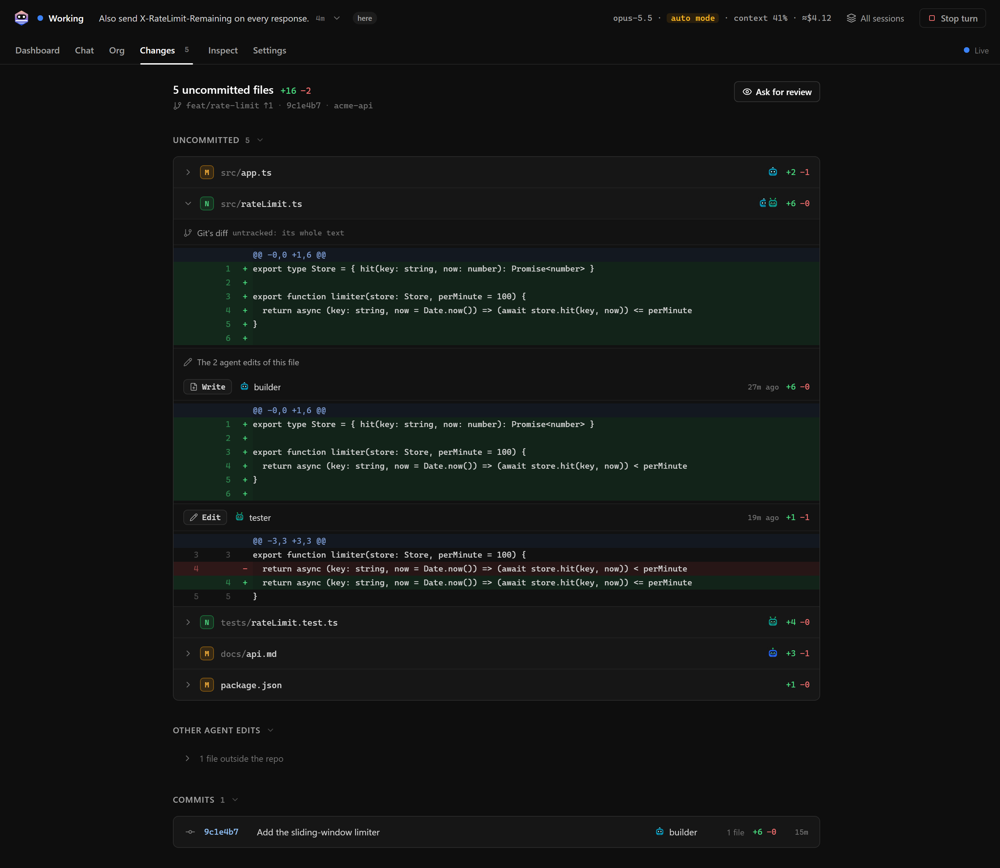
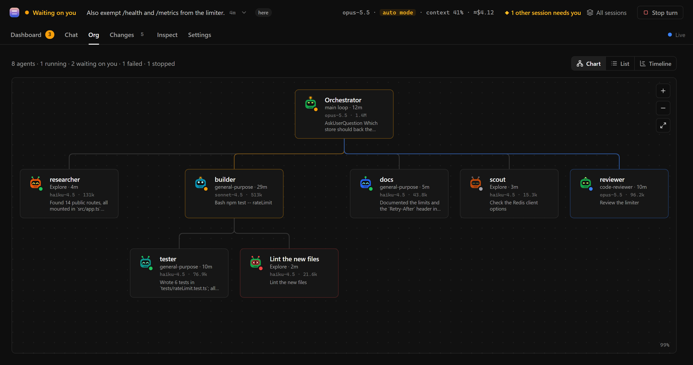
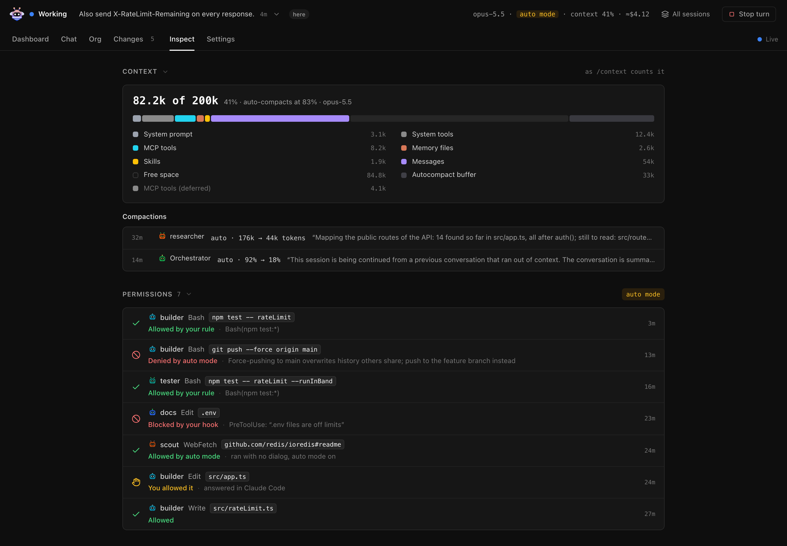

[Install](#install) · [What you see](#what-you-see) · [Examples](#examples) · [Commands](#commands) · [How it works](#how-it-works) · [Privacy](#privacy)

[](https://github.com/yusuflkq/apiarius/actions/workflows/test.yml) [](LICENSE)


When you run a team of agents, Claude Code doesn't make it easy to tell which ones are still working, which have finished and which are waiting on you. Apiarius is a mod that adds a live deck wherever you already work: the Claude Desktop side pane, the terminal or a browser tab. It shows every agent and subagent, what each one is doing right now, who started it, what they tell each other and which files each one changed. Nothing about your setup changes: install it, run `/apiarius` and keep working.

Apiarius only shows what Claude Code is already doing. It reads the events Claude Code reports and what git says about your files, and passes every permission check, tool call and prompt through unchanged. It acts only when you press something on the deck, and then through Claude Code's own channels.

## Install

This GitHub repository is its own plugin marketplace: its `.claude-plugin/marketplace.json` lists Apiarius. You add the repository once and install from it.

In a Claude Code session in the terminal, run:

```
/plugin marketplace add yusuflkq/apiarius
/plugin install apiarius@apiarius
```

The install shows what the plugin adds and asks where to install it. Install for you (user scope) puts it in every project.

From your shell, without starting a session, one command adds the marketplace and installs Apiarius for you. It needs Claude Code 2.1.292 or later.

```
claude plugin install apiarius --marketplace yusuflkq/apiarius
```

In the Claude Desktop app, `/plugin` doesn't run in the Code tab. The app has a plugin browser instead: in a local session, click + next to the prompt box and choose Add plugins (or Plugins, then Browse plugins). It lists the plugins from the marketplaces you have added, so add this one first from a terminal with `claude plugin marketplace add yusuflkq/apiarius`, then pick Apiarius in the browser. Or run the shell command above. The terminal and the Desktop app's local sessions read the same settings, so a plugin you install for yourself in one is there in the other.

It needs Claude Code 2.1.304 or later, in the terminal or in the Code tab of the Claude Desktop app, and Node.js 22 or later on your PATH. Node.js isn't only for the web page: Apiarius also uses it to make its folders private and clear out what a session leaves behind, to write the debug dump, to check which listed sessions still run, and to show the text of new files in Changes. Changes needs git 2.26 or later.

Then run `/apiarius`.

## What you see

The Dashboard has a card for each agent with what it is doing right now, then the session's figures, the plan, recent activity and the files the agents touched. When an agent asks you something, it shows at the top.

- Chat shows the session as a group chat, including the messages agents send each other.
- Org shows who started whom, as a chart or as a timeline of each agent's run.
- Changes shows git's diff of each uncommitted file next to each agent's own edits of it.
- Each agent has a page with its task, to-do list, result, tool calls and edits.
- Inspect shows what fills the context, every permission decision and who made it, what is loaded and the spend per agent.
- Background lists the background shells, agents and schedules still running.
- All sessions lists every Claude Code session on this machine that runs Apiarius, so one deck can check on all of them.

When you do need to step in, you can answer Claude's questions, message an agent, or stop an agent, a background task or the turn, from the deck.

| In Claude Desktop | In the terminal |
| :-: | :-: |
|  |  |
| Chat | Changes |
|  |  |
| Org chart | Inspect |
|  |  |

## Examples

Ask for work that several agents share:

```
Use three subagents in parallel to review src/auth: security, missing tests and docs.
```

Run `/apiarius` while they work. The Dashboard has a card for each of them with its current step, and Chat shows what each one reports back.

To answer Claude from the deck, have it ask you something:

```
Before you change anything, ask me which database to use.
```

The question shows at the top of the Dashboard with its options. Press one to answer, in the pane or on the web page.

After agents have edited files in a git repository, `/apiarius changes` shows git's diff of each uncommitted file next to the edits each agent made to it, so you can see who changed what.

To look around before you run any agents, use `/apiarius demo`. The deck shows a sample session in which a team of agents adds rate limiting to an API, with several things waiting on you. Nothing you press there reaches Claude, and Back to this chat returns to your own session.

## Commands

| Command | What it does |
| :- | :- |
| `/apiarius` | Opens the deck on the Dashboard |
| `/apiarius chat`, `org`, `changes`, `inspect`, `settings` | Opens that tab. A prefix works: `/apiarius i` is Inspect |
| `/apiarius sessions` | Opens All sessions |
| `/apiarius web` | Starts the web page and opens it in your own browser, as Open in browser at the top of the deck does |
| `/apiarius web pane` | Opens the web page in Claude's Browser pane in the Desktop app instead, where each message you send waits for one Send click above your prompt |
| `/apiarius web stop` | Stops the web page. Its links stop working |
| `/apiarius demo` | Shows the deck on sample data |
| `/apiarius clear` | Hides finished agents from the deck (Claude Code is untouched) |
| `/apiarius clear show` | Shows them again |
| `/apiarius avatars [style]` | Lists the eleven avatar styles, or picks one |
| `/apiarius band` | Hides or shows the status line above the prompt |
| `/apiarius close` | Closes the deck |

Keys work while the pane has the keyboard (click it, or press ctrl+x then tab): `1` to `6` switch tabs, `Enter` opens what has the focus, `b` goes back from an agent's page, `s` opens All sessions, and `o` opens the deck in your own browser, as Open in browser does. The web page adds a few of its own, listed under Help in its Settings.

## How it works

Apiarius hooks Claude Code's events (tool calls, agent spawns, turns, messages, permission checks and notifications) into one model of the session, which the pane, the terminal and the web page all draw from. Everything it shows comes from what Claude Code and git report. Changes never credits a git hunk to an agent: the edits beside git's diff are the patches from each agent's own Edit and Write calls.

When you step in, it acts only through Claude Code's own channels: answering the questions Claude asks you, delivering your messages, TaskStop for background agents and tasks, CronDelete for schedules, and the same abort as Esc for the turn. Stop and Cancel appear only where Claude Code's permission check allows that call, and the check runs again before each press. Apiarius never grants itself a permission and never answers a permission prompt. In auto mode, where Claude Code refuses a plugin's message to a subagent, the deck asks the Orchestrator to pass yours on, and that request shows in the chat.

Where Claude Code loads its built-in guard (on a Team or Enterprise login, or a machine with managed settings), a mod's hooks on `classic.*` events, `session.compact` and `prompt.context` don't run. The agents, their tool calls and messages, Changes, Claude's questions and Stop all still work there. Permission prompts and Claude Code's notifications don't show as waiting on you, though, and Inspect has no compactions, instruction files or permission mode.

## Privacy

- Apiarius makes no network requests of its own. What it hands to Claude goes through Claude Code like anything you type.
- It reads Claude Code's events for the session, the session's transcript and what git says about your repositories. Its files live in `~/.claude/apiarius/`, in folders only you can open, and a session's files go when the session ends. The debug dump, which you turn on yourself, stays until you delete it.
- The web page runs only after you start it. It listens on 127.0.0.1, each link to it opens one page, and Apiarius never hands a link to Claude.
- Claude can drive the Desktop app's Browser pane, so a message, an answer or a Review you send from the page there waits for your Send above the prompt. From your own browser it goes at once.

[PRIVACY.md](PRIVACY.md) has the rest: everything Apiarius runs, writes and reads, and what stays as it is.

## Support

Report bugs and ask for features in [GitHub issues](https://github.com/yusuflkq/apiarius/issues). Report a security problem privately instead, as [SECURITY.md](SECURITY.md) describes.

A dump of what the deck believes helps with a bug. Create the folder `~/.claude/apiarius/debug/` and Apiarius writes `<session id>.json` there about 2 seconds after each change. Check that it holds nothing private before you attach it, and delete the folder to stop the dump.

## Development

See [CONTRIBUTING.md](CONTRIBUTING.md). To try a clone without installing it, run `claude --plugin-dir .` in its folder. `/apiarius probe` toggles a test pane for mod authors.

```
claude plugin validate .
scripts/test.sh          # the mod's tests, one file at a time
node --test web/test/    # the server and page tests
node web/dev.js          # the web page on sample data; prints its link
```

## License

MIT. See [LICENSE](LICENSE).
