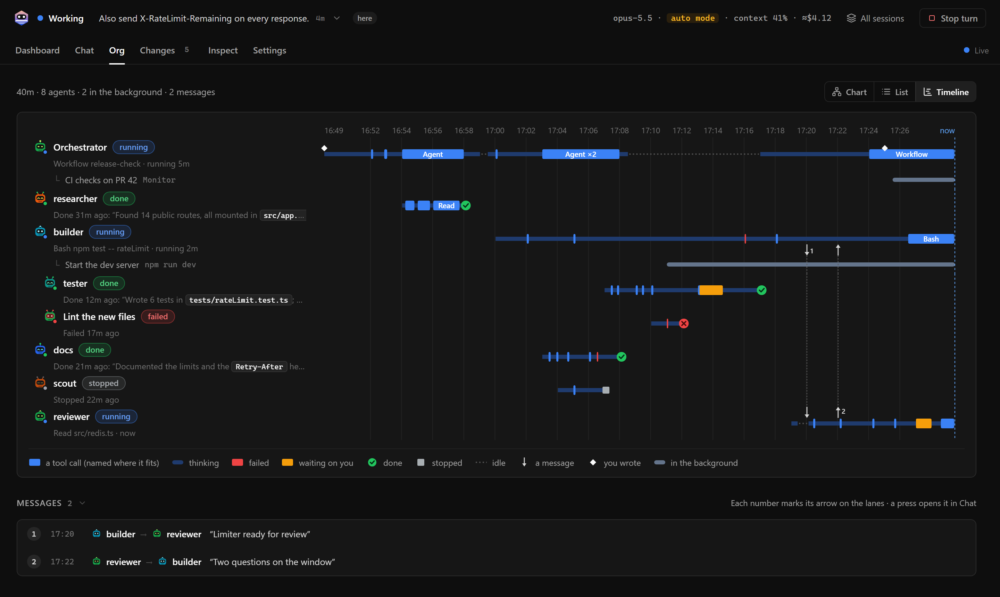
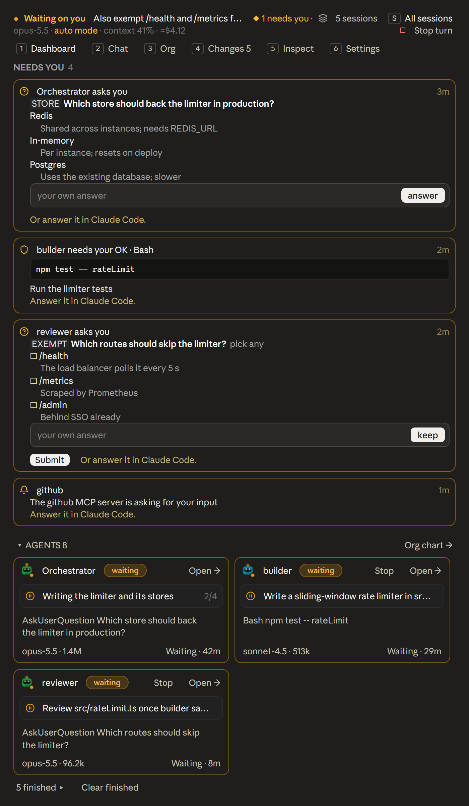

# Apiarius

See what every agent and subagent in your Claude Code session is doing, live.

[](https://github.com/yusuflkq/apiarius/actions/workflows/test.yml)
[](LICENSE)


Apiarius is a Claude Code mod for people who hand work to agents and subagents. `/apiarius` opens the deck: every agent in the session, what each one is doing, who started whom, what they tell each other and what they changed, updated as they work. It shows you how your orchestration actually plays out. The deck opens in the Claude Desktop side pane, in the terminal, or in your browser.

## Install

```
/plugin marketplace add yusuflkq/apiarius
/plugin install apiarius@apiarius
```

On Claude Code 2.1.275 or later you can do it in one step:

```
/plugin install apiarius --marketplace yusuflkq/apiarius
```

It needs Claude Code 2.1.287 or later in the terminal, or the Code tab of the Claude Desktop app (2.1.286 or later). The web page needs Node.js 18 or later on your PATH, and Changes needs git.

Then run `/apiarius`.

## What you see

The Dashboard has a card for each agent with what it is doing right now, then the session's figures, the plan, recent activity and the files the agents touched. When an agent asks you something, it shows at the top.

- Chat shows the session as a group chat, including the messages agents send each other.
- Org shows who started whom. Its Timeline gives each agent a row across the run with its work, its waits on you and its idle time.
- Changes shows git's diff of each uncommitted file next to each agent's own edits of it.
- Each agent has a page with its task, to-do list, result, tool calls and edits.
- Inspect shows what fills the context, every permission decision and who made it, what is loaded and the spend per agent.
- Background lists the background shells, agents and schedules still running.
- All sessions lists every Claude Code session on this machine that runs Apiarius, so one deck can check on all of them.

When you do need to step in, you can answer Claude's questions, message an agent, or stop an agent, a background task or the turn, from the deck.

| Chat | Changes |
| :-: | :-: |
|  |  |
| Timeline | Inspect |
|  |  |
| Claude Desktop side pane | Terminal |
|  |  |

## Commands

| Command | What it does |
| :- | :- |
| `/apiarius` | Opens the deck on the Dashboard |
| `/apiarius chat`, `org`, `changes`, `inspect`, `settings` | Opens that tab. A prefix works: `/apiarius i` is Inspect |
| `/apiarius sessions` | Opens All sessions |
| `/apiarius web` | Starts the web page and answers with its link |
| `/apiarius web stop` | Stops the web page. The next start gives a new link |
| `/apiarius demo` | Shows the deck on sample data |
| `/apiarius clear` | Hides finished agents from the deck (Claude Code is untouched) |
| `/apiarius clear show` | Shows them again |
| `/apiarius avatars [style]` | Lists the ten avatar styles, or picks one |
| `/apiarius band` | Hides or shows the status line above the prompt |
| `/apiarius close` | Closes the deck |
| `/apiarius probe` | Toggles a test pane for mod authors |

Keys work while the pane has the keyboard (click it, or press ctrl+x then tab): `1` to `6` switch tabs, `Enter` opens what has the focus, `b` goes back from an agent's page, and `s` opens All sessions. The web page adds a few of its own, listed under Help in its Settings.

## How it works

Apiarius hooks Claude Code's events (tool calls, agent spawns, turns, messages, permission checks and notifications) into one model of the session, which the pane, the terminal and the web page all draw from. Everything it shows comes from what Claude Code and git report. Changes never credits a git hunk to an agent: the edits beside git's diff are the patches from each agent's own Edit and Write calls.

When you step in, it acts only through Claude Code's own channels: answering the questions Claude asks you, delivering your messages, TaskStop for background agents and tasks, CronDelete for schedules, and the same abort as Esc for the turn. Stop and Cancel appear only where Claude Code's permission check allows that call, and the check runs again before each press. Apiarius never grants itself a permission and never answers a permission prompt. In auto mode, where Claude Code refuses a plugin's message to a subagent, the deck asks the Orchestrator to pass yours on, and that request shows in the chat.

## What it runs and stores

Apiarius makes no network requests of its own. What it hands to Claude goes through Claude Code like anything you type: your messages to agents, your answers to Claude's questions, and a note with the web page's link. Nothing is sent anywhere else.

`/apiarius web` runs `node web/server.js` from the plugin's folder as a child process of the session. The server has no dependencies and listens on 127.0.0.1 only, on a port the system picks; a reload of the mod asks for the same port again. It refuses any request without a random token, which reaches the server in an environment variable and reaches you in the link; `/apiarius web stop` discards it. It also refuses requests addressed to any other host name, and takes commands only from its own page. The page loads nothing from the internet. The server exits with the session, on `/apiarius web stop`, or when its parent process is gone. On the Desktop the command asks the Browser pane to open the page through the pane's `preview_start` MCP tool. Its answer leaves Claude the note with the link, so Claude can open the page when you ask.

For Changes it runs read-only git commands (`rev-parse`, `status`, `diff`, `log`, `rev-list`, `show`) in the session's repository or the ones its agents edit in, with `--no-optional-locks`, no pager or prompts, and `--no-ext-diff --no-textconv` on diffs. They run after edits and shell commands, and every 6 seconds while a deck is open. Short `node` one-liners read the session's process id, check whether other listed sessions' processes still run, and delete registry and inbox files the mod made.

It writes:

- `~/.claude/apiarius/sessions/<sessionId>.json` (under `CLAUDE_CONFIG_DIR` when set), so All sessions can list the session: its title, folder, repository, state, what needs you, what it is doing, its agents at work, its spend estimate and its process id. It is rewritten at most every 2 seconds and on a 30-second heartbeat, and deleted when the session ends or, if the session died, by another deck.
- `.web/<sessionId>/` in the plugin's folder: the page's `state.json` and the files it loads on demand (patches, git diffs, long messages, agent pages, the timeline), written only while the web page is on or another session's deck is showing this one. That deck leaves its requests in `inbox/` there.
- `.debug/<sessionId>.json` in the plugin's folder, a dump of the deck's state, only while a `.debug` folder exists there.

Claude Code's plugin storage keeps your preferences (avatar style, the band) and, for each session, the deck's snapshot and the web page's token and port, so a reload of the mod keeps its place. Apiarius reads the files agents edit, the session's transcript, Claude Code's settings for Inspect, and other sessions' registry files and state folders.

## Development

See [CONTRIBUTING.md](CONTRIBUTING.md). To try a clone without installing it, run `claude --plugin-dir .` in its folder.

```
claude plugin validate .
claude plugin test .     # the mod's tests
node --test web/test/    # the server and page tests
node web/dev.js          # the web page on sample data; prints its link
```

## License

MIT. See [LICENSE](LICENSE).
